# Casino Search — affiliate casino review platform

A full-stack, SEO-oriented platform for casino reviews, categories and articles, with an admin panel and an **affiliate click tracker** (`/out/:linkId` redirect with sub-ID templating and click logging).

> All casinos, bonuses and affiliate URLs in the demo data are **fictional** (`example.com`).

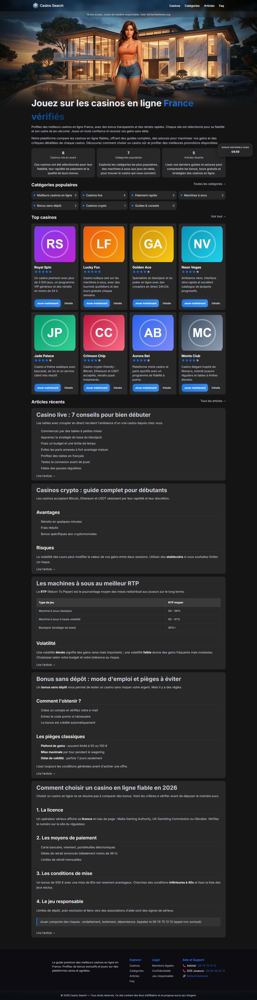

## Features

- **Public site (French, SEO-first)** — home, casino list and review pages, nested categories, Markdown articles, FAQ, legal/responsible-gambling pages
- **SEO** — ISR (`revalidate`), per-page metadata and Open Graph, Schema.org JSON-LD (`ItemList`, `Article`, `FAQPage`), `sitemap.xml`, `robots.txt`
- **Affiliate tracking** — `/out/[id]` builds the partner URL from a template (`s1={clickId}&src={source}&gclid={gclid}`), stores the click (hashed IP + UA, `gclid`/`gbraid`, source) and issues a 302
- **Admin panel** — dashboard with 24h/30d click stats and top casinos, CRUD for casinos, affiliate links, bonuses, categories (tree) and articles, paginated click log
- **Auth** — NextAuth credentials provider (JWT), role-based access (`ADMIN`); every server action re-checks the role
- **Safe Markdown** — rendered with `markdown-it` and sanitized with DOMPurify
- **Bonus wheel** widget with a persistent countdown

## Tech stack

Next.js 16 (App Router, Server Actions) · React 19 · TypeScript · Prisma 6 · PostgreSQL · NextAuth v4 · Zod · Sass · Tailwind 4 · Framer Motion

## Screenshots

| Casinos | Casino review |
|---|---|
| 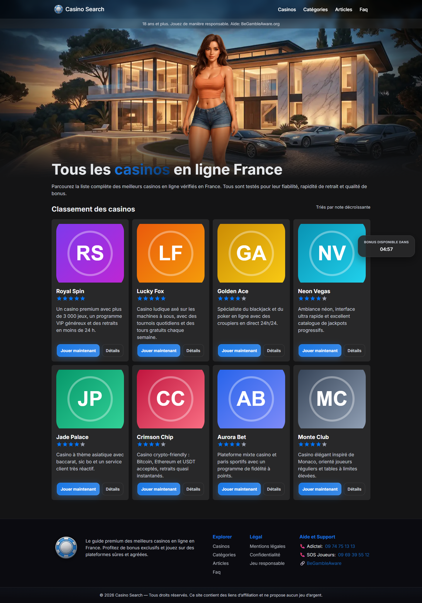 | 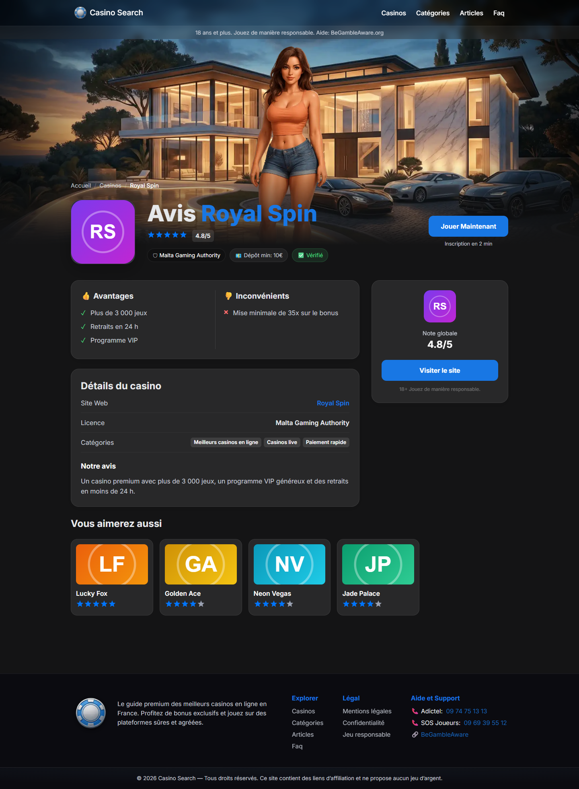 |

| Categories | Article |
|---|---|
| 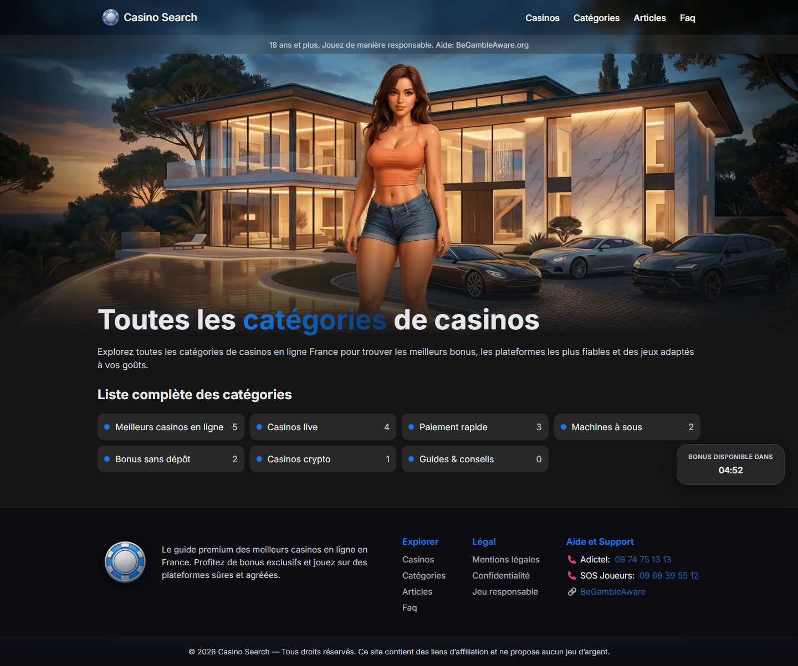 | 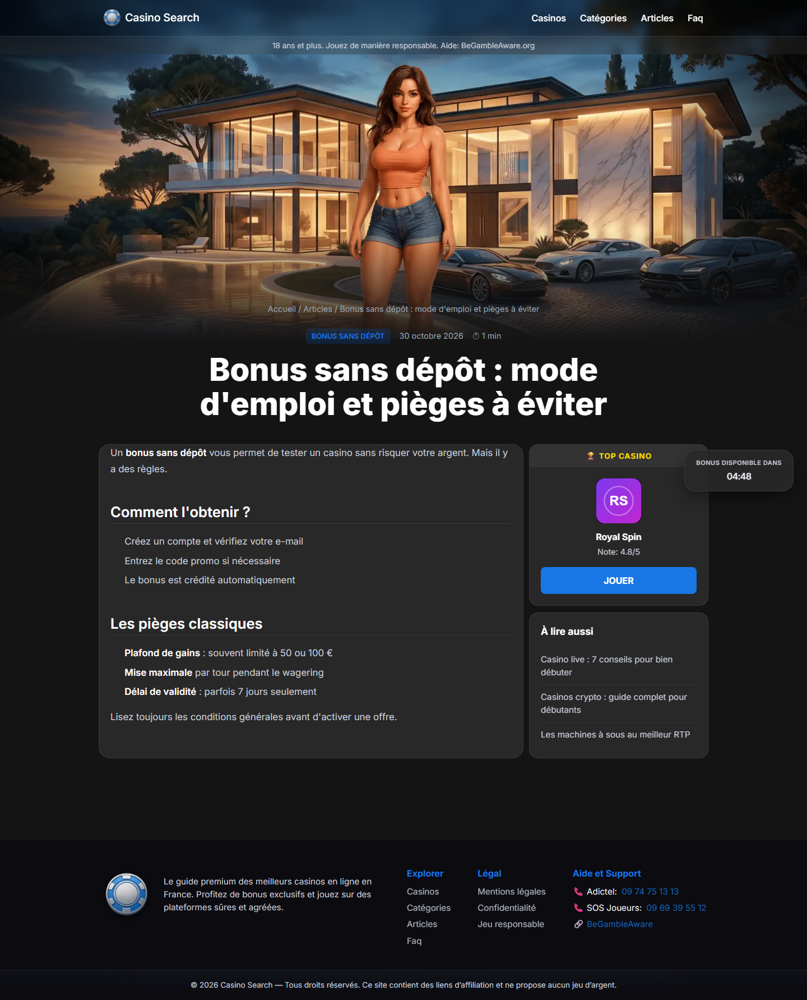 |

| Mobile | Admin dashboard |
|---|---|
| 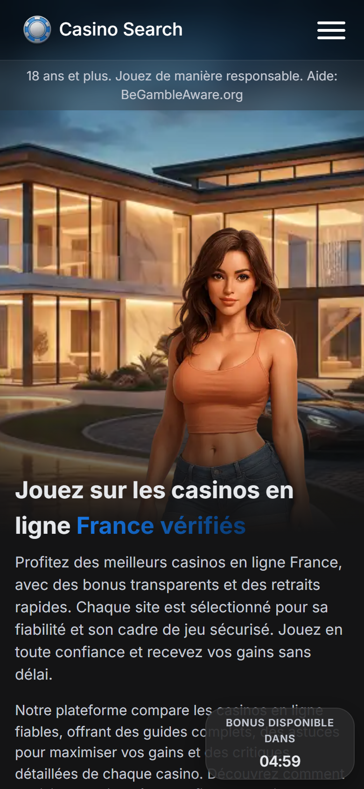 | 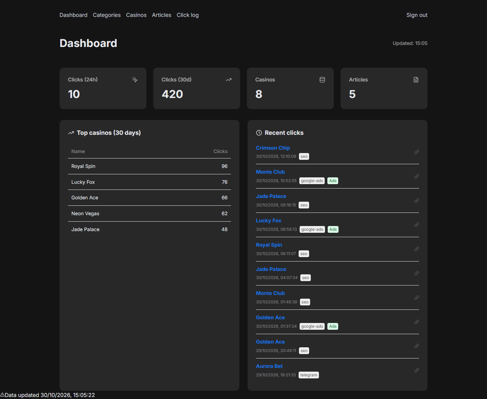 |

| Admin — casinos | Admin — click log |
|---|---|
| 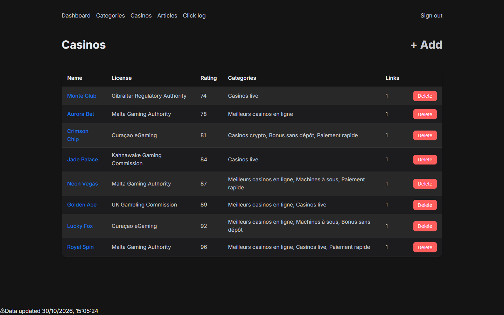 | 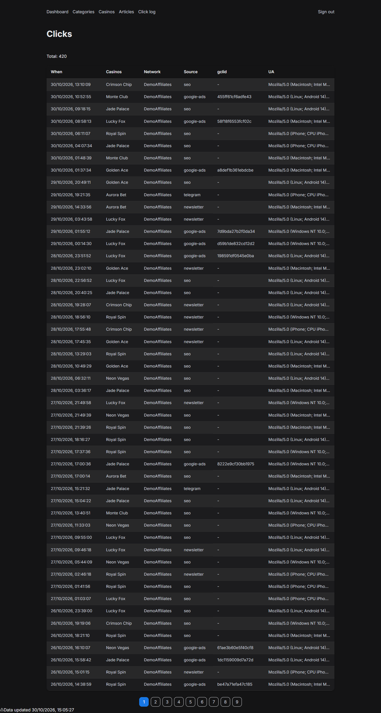 |

More: [login](docs/screenshots/login.png) · [articles](docs/screenshots/articles.png) · [FAQ](docs/screenshots/faq.png) · [admin articles](docs/screenshots/admin-articles.png)

## Architecture

```mermaid
flowchart LR
    V[Visitor] -->|SSR / ISR| S[Next.js App Router<br/>public pages]
    V -->|click "Play now"| O["/out/:linkId<br/>route handler"]
    O -->|log click| DB[(PostgreSQL)]
    O -->|302 + sub-IDs| P[Affiliate partner]
    S -->|Prisma| DB
    A[Admin] -->|NextAuth JWT| AD[Admin pages<br/>+ Server Actions]
    AD -->|requireAdmin + Zod| DB
```

### Data model

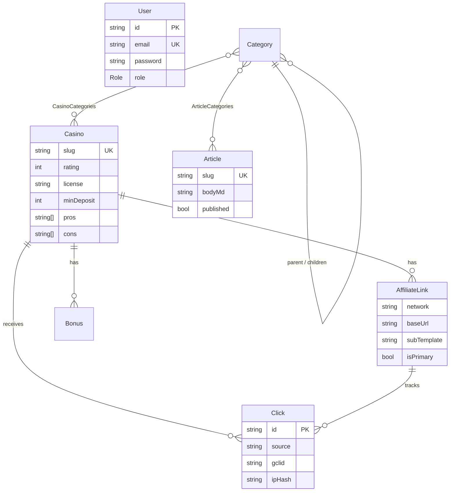

### Click tracking flow

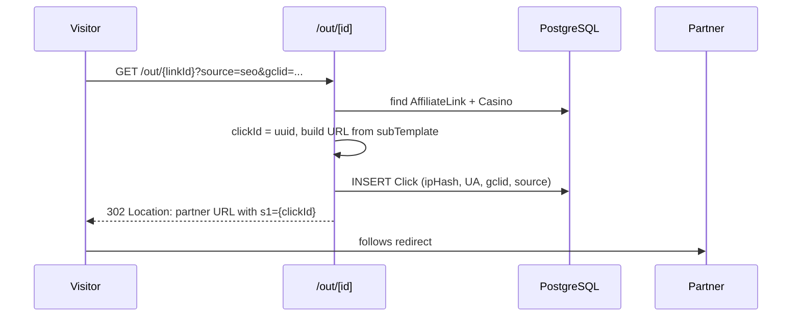

## Getting started

Requirements: Node.js 20+, Docker (or any PostgreSQL 14+).

```bash
git clone <repo-url> && cd casino-ref
npm install

cp env.example .env           # adjust values if needed
docker compose up -d          # PostgreSQL on :5432

npx prisma migrate deploy     # create tables
npx prisma db seed            # admin user + demo casinos, articles, clicks

npm run dev                   # http://localhost:3000
```

Admin panel: <http://localhost:3000/login> — credentials come from `NEXT_ADMIN_EMAIL` / `NEXT_ADMIN_PASSWORD` in `.env` (defaults: `admin@example.com` / `AdminPass404`). **Change them for any real deployment.**

### Environment variables

| Variable | Description |
|---|---|
| `DATABASE_URL` | PostgreSQL connection string |
| `NEXTAUTH_URL`, `NEXTAUTH_SECRET` | NextAuth base URL and a long random secret |
| `NEXT_ADMIN_EMAIL`, `NEXT_ADMIN_PASSWORD` | Admin account created by the seed |
| `NEXT_PUBLIC_SITE_NAME`, `NEXT_PUBLIC_SITE_URL`, `NEXT_PUBLIC_SITE_MAIL` | Site metadata |
| `NEXT_PUBLIC_GA_ID` | Optional Google Analytics ID |

### Scripts

| Command | Purpose |
|---|---|
| `npm run dev` | Development server |
| `npm run build && npm start` | Production build and server |
| `npx prisma studio` | Browse the database |
| `npx prisma db seed` | (Re)load demo data — idempotent |

## Project structure

```
app/
  (site)/        public pages (home, casinos, categories, articles, faq, legal)
  admin/         dashboard + CRUD, server actions guarded by requireAdmin()
  api/           NextAuth + bonuses endpoint
  out/[id]/      affiliate redirect + click logging
lib/             prisma client, auth helpers
prisma/          schema, migrations, seed
docs/screenshots
```

## Deployment notes

```bash
git pull && npm ci && npx prisma migrate deploy && npm run build && pm2 restart all
```

## Disclaimer

Portfolio project. Gambling involves risk; the demo content is fictional and not an offer to gamble.
